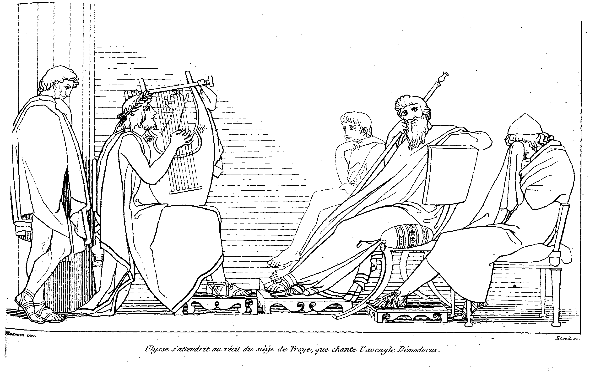
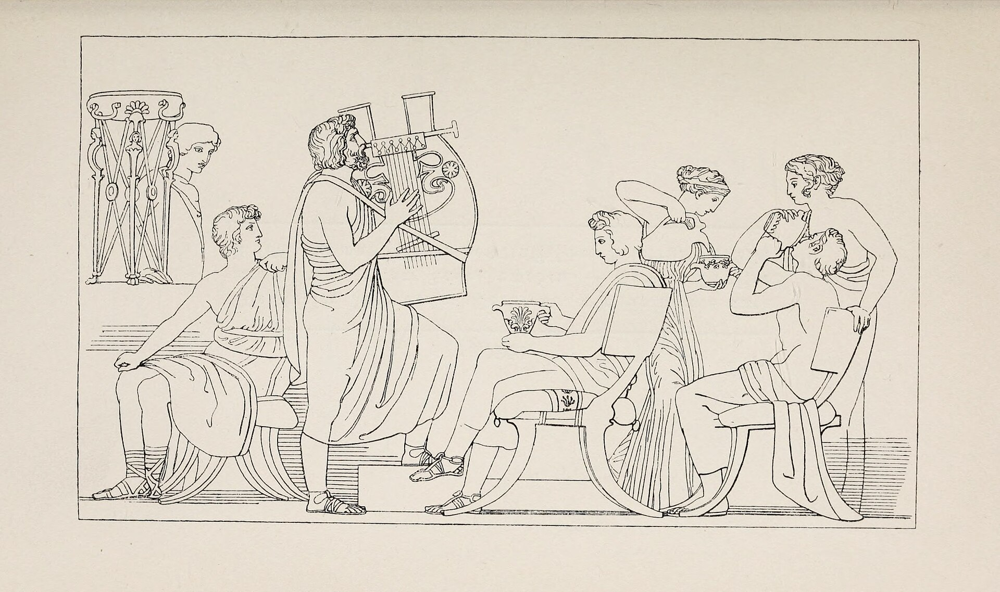

# FYW 1141 Homer And History

---

<!-- _class: img-left -->

Talk about fate as it relates to the storytelling of the Odyssey (**fate as poet's tool**)
- influenced *by* popular religion, and *influencing* popular religion (Dietrich)
- *how* the poets talk about fate
    - formulae?
    - aspect of "fate" verbs (aorist vs. perfect vs. past perfect)
 
<figure>
    
    <figcaption>Demodocus sings of Troy</figcaption>
</figure>

---

Phemius (in a very desperate moment) on being a singer-of-tales: 
He is a "bard... who sings for gods and men" (22.371)
Phemius: 
"I am self-taught, and a god has planted in my heart
All sorts of songs and stories, and I can sing to you
As to a god..." (22.372-22.374)

---

<!-- _class: img-right -->

What role does the "instrument of fate" play in this divinely inspired song? Is this language/knowledge given to aid the singer in the telling/making of the song?

<figure>
    
    <figcaption>Phemius sings to the Suitors</figcaption>
</figure>

---

<!-- _class: img-left -->

## Fate, the gods, and popular belief

Lorem ipsum dolor sit amet

<figure>
    
    <figcaption>The Moirai</figcaption>
</figure>

---

## Aorist and Passive

How ancient Greeks talked about the past had a lot to do with perspective- how does the past relate to now/what is said, e.g., the ancient Greeks generally conceived of the flow of time as looking into the past while moving backwards into the future.
- Homeric use of ἐπικλώθω
    - why aorist ἑπέκλωσεν (16.64), ἐπεκλώσαντο (1.17), ἐπέκλωσαν (3.208)?
- Homeric use of passive voice for "fate verbs"

---

Define fate as external (Kierkegaard?), things that happen to you. It seems like the Homeric conception of external happenings is that these can be boiled down to the fault of the gods, of some fate (μοίρα?) connected to the gods/separate from the gods, or somebody else, and maybe a combination of these things...
e.g., "some god" leading Helen to torment the Acheans in the Trojan Horse. Odysseus' actions were up to him, but the circumstances were because of Helen, and ultimately (maybe not actually) "some god".

---

The gods influencing the external:
"[Zeus,] You have no pity for men. You beget them,
Then plunge them into misery and pain." 
(20.215-20.216)
Notice that this comes from Philoetius, who is not a priest, theologian, or philosopher, simply someone who believes the popular relgion (which influenced the Homeric poets but was then influenced by the Homeric poets- themselves artists, not theologians!).

---

"Some god has wrapped [Penelope] up in sleep" (22.454)
Not only does Eurycleia express the characters' understanding of this, but maybe also reflects popular belief? Note that the singer-poet also tells us multiple times (formula?) that "some god" or "Athena" casts sleep upon people (usually Penelope, but Odysseus too (Thrinacia))

---

What about gods influencing the **internal** (thoughts, emotions, etc.)? Or manipulating how people look?
- "Owl-eyed Athena now prompted Penelope..." (21.1)
    - But is a 'prompting' still something external?

---

Do the gods have certain limits?
"But even the gods cannot ward off death,
The great leveler, from a man they love,
Not when destiny comes to lay him low."
3.261-3.263

The gods have certain "wills/plans", (Athena's machinations (20.310-20.312)) but we see Poseidon's will is limited by Zeus, and the gods are generally limited?

---

And yet, Zeus (sometimes Athena, and sometimes they are [indistinguishable from each other](https://github.com/percivale5/Homeric_Research/blob/main/TWHF_Quote.md)) has the "overpowering aegis" (22.316).

---

Compare these two passages:

|"They took his advice and gave it their best, But Athena made their shots all come to nothing..." 22.271-22.272|"He spoke and they all threw their sharp spears With deadly aim..." 22.280-22.281|
|---|---|

There's an apparently strange coexistence of human effort being secondary to divine will and human effort being ultimately triumphant. Maybe the divide itsn't so simple.

---

Odysseus says of the dead suitors:
"...These men
Have been destroyed *by divine destiny*
***And** their own recklessness*..." (22.436-22.438)
Indeed, "they have brought **upon themselves** / An ugly **fate**" (22.440-22.441)
 
Interesting...

---

Do humans have choice/responsibility? 
Peisistratus' maxim:
"All men have need of the immortal gods."
 3.54

---

Can the gods' influences (fate generally) *excuse* human behavior?
Menelaus says to Helen (and it is hard to recognize if he says so seriously or sarcastically):
"Some god who favored the Trojans / Must have lured you on" (to the disguised Acheans, whom Helen promptly began to torture, "until Athena led [Helen] off") (4.294-4.295, 4.309).
Kierkegaard (Haufniensis) notes that the Greeks really struggled with resolving apparent fate (external) and responsibility and guilt (internal).